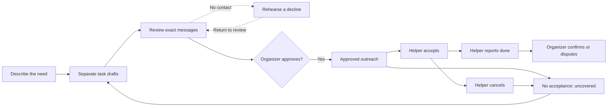

# Relief Atlas

### A little less coordination. A little more care.

“Can someone bring dinner Friday and check on Dad Saturday?”

Then Sam’s shift changes. Saturday’s message still has no reply. Monday’s ride has a volunteer, but the meal someone reported dropping off still needs confirmation. The organizer has to work out what is actually covered.

Relief Atlas brings those decisions into one place. It coordinates nonmedical meals, visits and rides among invited family and friends. The organizer reviews separate drafts and exact messages before outreach. If a helper cancels, the original failure stays visible and a replacement needs a new approval.

## Follow one clear next step

**Home** shows one prioritized next action. **Plan** lists requests in calendar order. **People** holds invitations, availability and circle settings. Open a task when you need its private details, offer receipts or history. Maps, diagnostics and the optional 3D illustration live under **More options → Tools & diagnostics**.

Creating a request is guided: describe the need, edit one task at a time, then inspect each saved message before approving the exact plan. Leaving unsaved edits requires an explicit choice.



An offer being available or sent does not mean someone accepted. Acceptance does not mean the work is done. Helper-reported completion still needs organizer confirmation. Rehearsal, parsing and MCP tools cannot approve or dispatch.

## Run it locally

Use **Node.js 24** and **pnpm 11.19.0**.

```sh
git clone https://github.com/usmanmohammed2306/relief-atlas.git
cd relief-atlas
pnpm install --frozen-lockfile
pnpm typecheck
pnpm build

DEMO_MODE=true \
DEMO_PUBLIC_CONFIRM=fictional-data-only \
DELIVERY_MODE=simulated \
RELIEF_PROPOSER=deterministic \
APP_ORIGIN=http://localhost:4000 \
pnpm start
```

Open **http://localhost:4000**. No AWS account, model key, email credential or separate database is needed. These commands use macOS/Linux shell syntax. Stop with Ctrl+C. Fictional data persists under `apps/api/.relief-data/`, which is excluded from Git.

For hot reload, use `DEMO_MODE=true RELIEF_PROPOSER=deterministic pnpm dev`. The web app runs on port 5173 and proxies the API on port 4000.

## Try the whole journey

1. Choose **Alex**, the fictional organizer, and select **Ask for help**. Enter `Bring dinner tomorrow at 6pm and check on Dad tomorrow at 10am`.
2. Continue through both tasks. Check the dates and select only **Sam Morgan** on each task to make a decline leave a visible gap. Private notes and locations are optional.
3. Save and review each exact message. Optionally rehearse Sam declining. Nothing has been sent or accepted.
4. Approve the saved plan. The local worker simulates delivery; wait for the offers to become available.
5. Switch to **Sam**. Accept one offer and report it done. Decline the other.
6. Return to **Alex**. Confirm the reported task, inspect the uncovered task and prepare a replacement draft with a new approval.

Under **People**, helpers can set contact windows, supported task types and up to 60 unavailable dates in their timezone. An unblocked date is not a promise of availability. Changing preferences never silently cancels an existing commitment.

## Privacy and recovery

- Only an authenticated organizer can approve the exact saved plan. Changed facts require another saved review.
- Helper access is household-scoped and revocable. Private locations and instructions require acceptance.
- Approval atomically creates requests, offer snapshots, durable jobs and append-only events. Approval replay returns the original request IDs.
- Workers recheck consent and eligibility. Retries, lease tokens and offer generations prevent obsolete results from replacing newer state. External email deduplication still depends on the provider.
- Organizers can export a circle or close it with exact-name confirmation under **People → Circle settings**. Closure stops access and unfinished work while preserving history. It is not deletion.

The app includes a privacy/support screen and a support-summary download that excludes family details and authentication tokens. Contact: [musmanme@asu.edu](mailto:musmanme@asu.edu). This address does not imply ASU endorsement.

## How it works

| Layer | Implementation |
| --- | --- |
| Interface | React 19, TypeScript and Vite; Daylight/Night, reduced motion and optional Three.js illustration |
| API | Fastify, Zod, deterministic authorization and state transitions |
| Data | Local PGlite; PostgreSQL-compatible schema and migrations |
| Background work | Transactional database jobs, retries, lease fencing and deadline checks |
| MCP | Real Streamable HTTP endpoint at `/mcp`; protocol 2025-11-25 tested with the SDK client |
| Authentication | Fictional selectable identities in demo mode; Cognito and an alternate Supabase adapter require separate configuration |
| Optional model | AWS Bedrock Converse proposal adapter, disabled by default |

The five MCP tools create draft plans, rehearse a decline, read request status and summarize coverage. They expose no approval or dispatch capability. The conversational web flow uses real MCP, but it is not a live Alexa+ integration or an autonomous agent system.

**The local app uses deterministic drafting, not a live AI model.** The optional Bedrock adapter has validation, replay handling and database-backed usage reservations. Its live model quality has not been established. The local demo makes no model or real email calls.

## What has been verified

October 24, 2026: the maintainer workspace has passing receipts for 12 distinct browser journeys and 51 UI model checks covering guided review, approval boundaries, privacy, recovery, responsive layouts and unsaved edits. The browser receipts include focused reruns, not a single 12/12 suite run. These are fictional local checks, not user-study results or a production reliability rate.

A separate, temporary AWS trial verified HTTPS, Cognito sign-in, private RDS TLS, exact approval, real MCP and interrupted-worker recovery using ECS and scheduled sweeps. Its application resources were torn down. The endpoint is offline. This minimal repository contains the runnable application, not the infrastructure, test harnesses, recordings or internal learning materials from that trial.

The exact updated publication checkout also passes web/API typechecks, the production build and 12 local runtime smoke assertions using newly built JavaScript, an isolated fictional database, a real MCP client and Chrome. Installed dependencies were reused; this was not a fresh dependency installation or another AWS trial.

## Honest limits

Relief Atlas is a prototype for nonmedical coordination. It does not vet helpers, guarantee attendance or provide emergency, medication or diagnosis advice. All demo people and data are fictional.

Real-household release still needs backup/restore verification, operated alerts, independent privacy/security and accessibility review, retention/deletion procedures and human comprehension testing. Real email, live Alexa+ and model-quality improvements are unverified. The temporary AWS trial does not establish ongoing hosting or production readiness. AWS credits do not cap spending.

## License

MIT. See [LICENSE](LICENSE). Third-party packages retain their own licenses.
