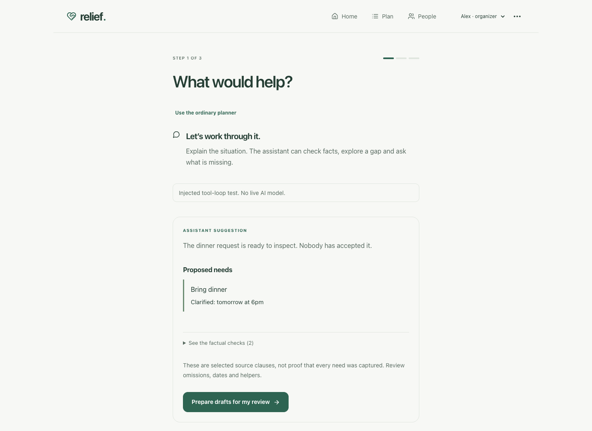
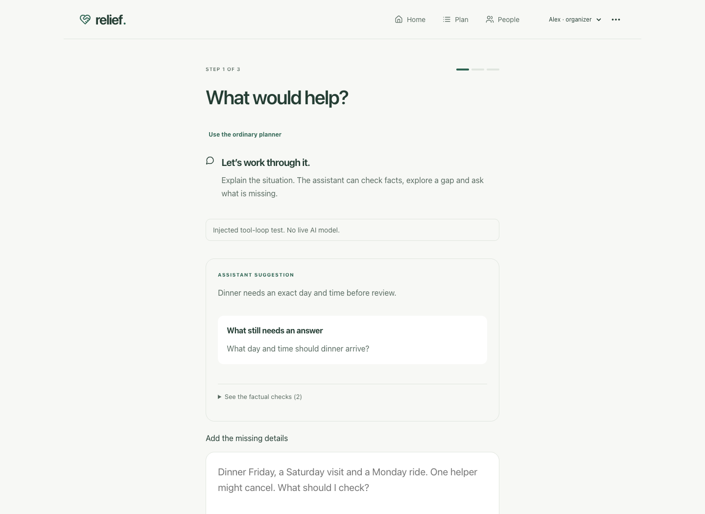
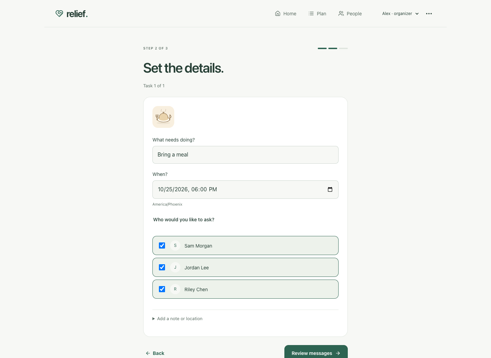
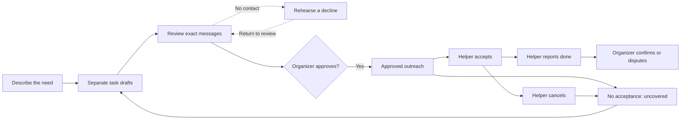
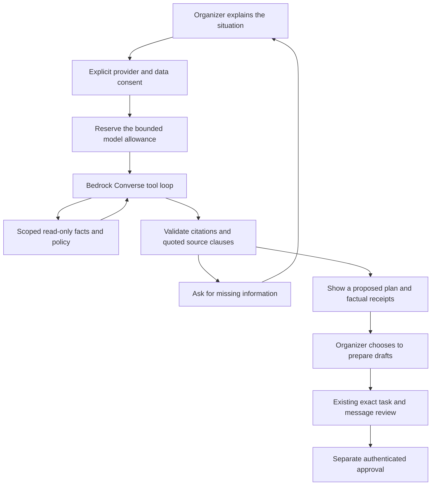

# Relief Atlas

### A little less coordination. A little more care.

“Can someone bring dinner Friday and check on Dad Saturday?”

Then Sam’s shift changes. Saturday’s message still has no reply. Monday’s ride has a volunteer, but the meal someone reported dropping off still needs confirmation. The organizer has to work out what is actually covered.

Relief Atlas brings those decisions into one place. It coordinates nonmedical meals, visits and rides among invited family and friends. The organizer reviews separate drafts and exact messages before outreach. If a helper cancels, the original failure stays visible and a replacement needs a new approval.

## See it in action

The screenshots below show the actual local application with fictional data. **Assistant responses are injected test fixtures, not live Bedrock inference.** No helper was contacted.



<details>
<summary>Start with a missing detail, then move into organizer review</summary>

The request begins with “Bring dinner.” The assistant asks when it should arrive instead of inventing a time.



After the organizer supplies a time and chooses **Prepare drafts for my review**, the ordinary planner opens. The organizer still checks the deadline, chooses helpers and inspects exact outgoing messages before a separate approval.



</details>

## Follow one clear next step

**Home** shows one prioritized next action. **Plan** lists requests in calendar order. **People** holds invitations, availability and circle settings. Open a task when you need its private details, offer receipts or history. Maps, diagnostics and the optional 3D illustration live under **More options → Tools & diagnostics**.

Creating a request is guided: describe the need, edit one task at a time, then inspect each saved message before approving the exact plan. Leaving unsaved edits requires an explicit choice.



An offer being available or sent does not mean someone accepted. Acceptance does not mean the work is done. Helper-reported completion still needs organizer confirmation. Rehearsal, parsing and MCP tools cannot approve or dispatch.

## Run it locally

Use **Node.js 24** and **pnpm 11.19.0**.

```sh
git clone https://github.com/usmanmohammed2306/relief-atlas.git
cd relief-atlas
pnpm install --frozen-lockfile
pnpm typecheck
pnpm build

DEMO_MODE=true \
DEMO_PUBLIC_CONFIRM=fictional-data-only \
DELIVERY_MODE=simulated \
RELIEF_PROPOSER=deterministic \
RELIEF_AGENT=disabled \
APP_ORIGIN=http://localhost:4000 \
pnpm start
```

Open **http://localhost:4000**. No AWS account, model key, email credential or separate database is needed. These commands use macOS/Linux shell syntax. Stop with Ctrl+C. Fictional data persists under `apps/api/.relief-data/`, which is excluded from Git.

For hot reload, use `DEMO_MODE=true RELIEF_PROPOSER=deterministic pnpm dev`. The web app runs on port 5173 and proxies the API on port 4000.

## Try the whole journey

1. Choose **Alex**, the fictional organizer, and select **Ask for help**. Enter `Bring dinner tomorrow at 6pm and check on Dad tomorrow at 10am`.
2. Continue through both tasks. Check the dates and select only **Sam Morgan** on each task to make a decline leave a visible gap. Private notes and locations are optional.
3. Save and review each exact message. Optionally rehearse Sam declining. Nothing has been sent or accepted.
4. Approve the saved plan. The local worker simulates delivery; wait for the offers to become available.
5. Switch to **Sam**. Accept one offer and report it done. Decline the other.
6. Return to **Alex**. Confirm the reported task, inspect the uncovered task and prepare a replacement draft with a new approval.

Under **People**, helpers can set contact windows, supported task types and up to 60 unavailable dates in their timezone. An unblocked date is not a promise of availability. Changing preferences never silently cancels an existing commitment.

## A planning agent with a clear boundary

A request is rarely the whole situation. Someone may be away, another helper may be in quiet hours, and a plan that looked covered yesterday may need attention today. The optional assistant can look up those constraints, ask a focused follow-up question and show the observations behind its advice.

The agent uses **Amazon Bedrock Converse client-side tool calling**. Its model can choose among four tools, inspect their results and continue within a bounded loop. These are its capabilities:

| Tool | What it checks | What it cannot establish |
| --- | --- | --- |
| `read_coverage` | Up to 20 current scoped task types, deadlines and statuses; truncation is explicit | A sent offer never becomes an acceptance |
| `check_helpers` | Active membership, opt-in, task types, quiet hours and unavailable dates | Eligibility is not a commitment or guaranteed attendance |
| `rehearse_gap` | Alternatives if one pseudonymous helper cannot help | No reassignment, real decline or contact occurs |
| `look_up_policy` | Curated approval, privacy, status and recovery rules | Policy retrieval grants no new authority |

The assistant can ask questions across **three conversation turns**. A completed proposal contains exact source quotations, known fact references and a visible tool receipt. Dates and helper eligibility are derived by deterministic code. The organizer explicitly transfers the proposal into draft review. **There is no approval, dispatch or completion tool.**



### Controls behind the conversation

- Each run reserves **four model calls** from the same SQL allowance used by the single-call proposer. A run permits at most four model calls and eight tool calls. Unused reservations are retained.
- Completed run keys replay stored results. Different input or scope conflicts. Pending/interrupted runs do not automatically retry. A late provider response cannot replace a stopped result.
- Active organizer access and circle consent are checked before work, around tool execution, after model responses and before persistence. Revocation stops subsequent work; it cannot recall text already sent to a provider.
- Retrieved records omit stored names, emails, task titles, notes, locations and instructions. Helper references are pseudonyms. Anything typed into the conversation can still reach the provider, so this trial interface is for fictional data only.
- Strict schemas reject unknown tools, extra arguments, authority fields and forged citation IDs. Source checks reject unsupported quotes and known unsafe cases. These checks do not prove complete need capture, semantic truth or general resistance to prompt injection.
- Model explanations are labeled suggestions. Tool receipts are point-in-time facts. Circle exports include completed assistant conversations; circle closure revokes access while retaining history.

The agent’s four tools are a separate client-side catalog. The existing **five-tool HTTP MCP server remains unchanged**. There is no claim that the new agent routes its tool calls through MCP or uses a multi-agent swarm.

### Enablement and cost

**Live inference is disabled by default and has not been verified.** The setup above runs the ordinary deterministic planner. When a reviewed agent provider is configured, **Ask for help → Talk it through with the assistant** appears. Consent is unchecked by default for each conversation.

These environment settings are required for a separately approved fictional Bedrock trial. They are configuration requirements, not instructions to spend or grant access now:

| Setting | Requirement |
| --- | --- |
| `RELIEF_AGENT` | `bedrock`; leave `RELIEF_PROPOSER=deterministic` if single-call model drafting is unnecessary |
| `RELIEF_MODEL_APPROVAL` | `owner-approved-fictional-trial`, only after actual account, data, access and cost review |
| `AWS_REGION`, `RELIEF_MODEL_ID` | Reviewed direct regional foundation model supporting Converse and tool use; cross-region inference profiles are rejected |
| `RELIEF_MODEL_MAX_CALLS_PER_DAY` | Owner-approved integer from 1 to 100; at least four remaining calls are required to reserve one agent run |
| `RELIEF_MODEL_DAILY_USD` | Owner-approved positive reservation allowance, at most $5 |
| `RELIEF_MODEL_INPUT_USD_PER_MILLION`, `RELIEF_MODEL_OUTPUT_USD_PER_MILLION` | Current verified regional token prices; no price defaults |

Use the normal AWS credential chain. The required invocation permission is `bedrock:InvokeModel` on the exact regional foundation-model ARN. Model access, billing and policy grants must be reviewed separately. The interface also requires explicit consent before each run. No account keys or credentials belong in this repository.

Allowances coordinate instances sharing one database. They are not an account-wide charge cap. Aborting a timeout does not guarantee processing or billing stopped. Token estimates can be incomplete, prices can change, and taxes or other services are outside the inference estimate. **AWS credits do not cap spending.**

Official reading: [Bedrock client-side tool use](https://docs.aws.amazon.com/bedrock/latest/userguide/tool-use-client-side.html), [Nova tool-schema restrictions](https://docs.aws.amazon.com/nova/latest/userguide/tool-use-definition.html), [Converse API](https://docs.aws.amazon.com/bedrock/latest/APIReference/API_runtime_Converse.html) and [current pricing](https://aws.amazon.com/bedrock/pricing/).

## Privacy and recovery

- Only an authenticated organizer can approve the exact saved plan. Changed facts require another saved review.
- Helper access is household-scoped and revocable. Private locations and instructions require acceptance.
- Approval atomically creates requests, offer snapshots, durable jobs and append-only events. Approval replay returns the original request IDs.
- Workers recheck consent and eligibility. Retries, lease tokens and offer generations prevent obsolete results from replacing newer state. External email deduplication still depends on the provider.
- Organizers can export a circle or close it with exact-name confirmation under **People → Circle settings**. Closure stops access and unfinished work while preserving history. It is not deletion.

The app includes a privacy/support screen and a support-summary download that excludes family details and authentication tokens. Contact: [musmanme@asu.edu](mailto:musmanme@asu.edu). This address does not imply ASU endorsement.

## How it works

| Layer | Implementation |
| --- | --- |
| Interface | React 19, TypeScript and Vite; Daylight/Night, reduced motion and optional Three.js illustration |
| API | Fastify, Zod, deterministic authorization and state transitions |
| Data | Local PGlite; PostgreSQL-compatible schema and migrations |
| Background work | Transactional database jobs, retries, lease fencing and deadline checks |
| MCP | Real Streamable HTTP endpoint at `/mcp`; protocol 2025-11-25 tested with the SDK client |
| Authentication | Fictional selectable identities in demo mode; Cognito and an alternate Supabase adapter require separate configuration |
| Optional AI | Bedrock Converse tool-using planning agent and a separate single-call proposer, both disabled by default |

The five MCP tools create draft plans, rehearse a decline, read request status and summarize coverage. They expose no approval or dispatch capability. The ordinary conversational drafting flow uses real MCP. The optional planning agent uses its separate restricted tool catalog. There is no live Alexa+ integration.

**The default local app uses deterministic drafting.** Bedrock proposal and agent adapters are implemented, with validation, replay handling and shared database-backed usage reservations. Their live inference and model quality have not been established. The default demo makes no model or real email calls.

## What has been verified

October 24, 2026: the agent increment passes **134/134 API tests**, including **17 agent contract tests**, and **51/51 UI model checks** in the maintainer workspace. Two focused Chrome journeys separately verify the injected agent conversation/handoff and the ordinary MCP approval/completion workflow. These are local/injected controls, not live model-quality scores.

The offline development comparison covers 15 authored, inspected scenarios. The deterministic baseline matches 12/15 authored expectations; its three misses are paraphrases. The agent has **zero live model calls and unmeasured language quality**. This is not an untouched holdout, independent user study or evidence of improvement over that baseline. Test harnesses and evaluation reports remain outside this minimal runtime repository.

The earlier interface revision has passing receipts for 12 distinct browser journeys and 51 UI model checks covering guided review, approval boundaries, privacy, recovery, responsive layouts and unsaved edits. The browser receipts include focused reruns, not a single 12/12 suite run. These are fictional local checks, not user-study results or a production reliability rate.

A separate, temporary AWS trial verified HTTPS, Cognito sign-in, private RDS TLS, exact approval, real MCP and interrupted-worker recovery using ECS and scheduled sweeps. Its application resources were torn down. The endpoint is offline. This minimal repository contains the runnable application, not the infrastructure, test harnesses, recordings or internal learning materials from that trial.

This exact publication checkout separately passes web/API typechecks and production builds, **13 local runtime smoke assertions** with a real MCP client and Chrome, and **8 injected agent runtime assertions** for consent, helper denial, clarification, replay, draft handoff, zero outreach and conversation export. These checks overlap in scope. Installed dependencies were reused; this was not a fresh dependency installation, live-model test or another AWS trial.

## Honest limits

Relief Atlas is a prototype for nonmedical coordination. It does not vet helpers, guarantee attendance or provide emergency, medication or diagnosis advice. All demo people and data are fictional.

Real-household release still needs backup/restore verification, operated alerts, independent privacy/security and accessibility review, retention/deletion procedures and human comprehension testing. Real email, live Alexa+ and model-quality improvements are unverified. The temporary AWS trial does not establish ongoing hosting or production readiness. AWS credits do not cap spending.

## License

MIT. See [LICENSE](LICENSE). Third-party packages retain their own licenses.
