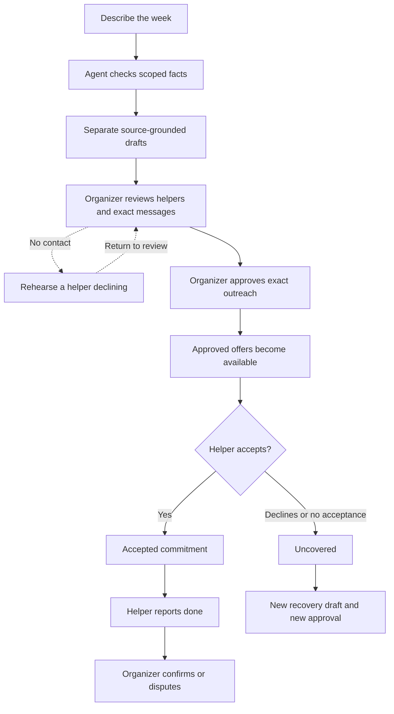

# Relief Atlas

### One conversation. A clearer week of help.

Alex is away for the week. Dad needs a ride on Monday, dinner on Friday and a check-in on Saturday. Sam is away on Friday. Later, he cannot make Saturday either.

In a group chat, those details get scattered across messages. Relief brings them into a plan the organizer can review and follow.

Its planning agent separates the needs, checks invited helpers’ boundaries and asks about missing details. Alex chooses who to ask and reviews each exact message. When Sam declines, Saturday stays visibly uncovered while the other commitments remain intact. A replacement starts with a new review.

## Talk through the week

This walkthrough uses fictional people, **real on-device AI** and simulated outreach. The screenshots come from the application, not mockups.


Sam’s saved Friday absence rules him out for dinner. Riley can be considered instead. Jordan offers rides. These are people who could be asked, not people who have already agreed.

## Know exactly what you are asking


Alex reviews every message before approving the plan. Private instructions stay hidden until a helper accepts. Reading a draft or rehearsing a failure never contacts anyone.

## See the gap when plans change


Jordan accepts the ride and Riley accepts dinner. Sam declines the visit, so Saturday says **Uncovered**. Relief keeps the failure in the history and opens an unapproved recovery draft. Nothing is silently reassigned.

An offer is not acceptance. Acceptance is not completion. Even after a helper reports something done, the organizer still confirms it.

## Run it yourself

Use **Node.js 24** and **pnpm 11.19.0**.

```sh
git clone https://github.com/usmanmohammed2306/relief-atlas.git
cd relief-atlas
pnpm install --frozen-lockfile
pnpm typecheck
pnpm build
```

### With local AI

Install [Ollama](https://ollama.com/download). Start a local-only model server in one terminal:

```sh
OLLAMA_NO_CLOUD=1 ollama serve
```

If another Ollama server already uses port 11434, stop that instance before starting this one. In a second terminal, download the instruction-tuned model:

```sh
ollama pull qwen3:4b-instruct
```

The model download is about 2.5 GB. This route uses your laptop and no paid model API. From the Relief repository, start the app:

```sh
DEMO_MODE=true \
DEMO_PUBLIC_CONFIRM=fictional-data-only \
DELIVERY_MODE=simulated \
RELIEF_PROPOSER=deterministic \
RELIEF_AGENT=ollama \
RELIEF_LOCAL_ORIGIN=http://127.0.0.1:11434 \
RELIEF_LOCAL_MODEL=qwen3:4b-instruct \
APP_ORIGIN=http://localhost:4000 \
pnpm start
```

Open **http://localhost:4000**, choose Alex, and select **Ask for help**. The assistant opens first when a provider is configured. Data consent is unchecked by default. Use fictional information and keep private details out of this prototype.

Try: `Drive Dad Monday at 9am and bring dinner Friday at 6pm and check on Dad Saturday at 10am`.

The screenshots use a deliberately configured fictional circle. A fresh demo has its own default helper preferences, so its suggestions may differ. Under **People**, helpers can set supported tasks, contact hours and unavailable dates. An unblocked date is never a promise of availability.

### Without a model

The ordinary planner works independently:

```sh
DEMO_MODE=true \
DEMO_PUBLIC_CONFIRM=fictional-data-only \
DELIVERY_MODE=simulated \
RELIEF_PROPOSER=deterministic \
RELIEF_AGENT=disabled \
APP_ORIGIN=http://localhost:4000 \
pnpm start
```

These commands use macOS/Linux shell syntax. No cloud account or separate database is needed for the fictional local demo. Stop the app with Ctrl+C. Fictional history persists under `apps/api/.relief-data/`, which is excluded from Git. For hot reload, use `DEMO_MODE=true RELIEF_AGENT=disabled pnpm dev`; the web app uses port 5173 and proxies the API on port 4000.

## How one request becomes a plan



**Home** shows the next useful review. **Plan** lists requests in calendar order. **People** holds invitations, availability and circle controls. Task details, history and technical receipts open when needed. The normal workflow stays focused on the next decision.

<details>
<summary><strong>Inside the planning agent</strong></summary>

The model can inspect four read-only capabilities:

| Tool | Purpose |
| --- | --- |
| `read_coverage` | Read up to 20 scoped task types, deadlines and statuses, with explicit truncation |
| `check_helpers` | Check membership, opt-in, task types, contact windows and unavailable dates |
| `rehearse_gap` | Inspect alternatives after excluding one known helper, without changing real work |
| `look_up_policy` | Retrieve the approval, privacy, status or recovery rule |

Local inference uses Ollama and Qwen3 4B Instruct. A typed final-answer formatter is separate from the four domain tools and executes no actions. The Bedrock Converse adapter remains available as a separately configured cloud option. **Bedrock inference has not been verified.**

Each run permits four model calls and eight domain tool calls. Conversations have at most three user turns. The existing SQL ledger reserves the whole possible call allowance before inference. Completed keys replay stored results; pending/interrupted keys never automatically reinvoke. Access is checked around model/tool work and before persistence.

The local adapter permits only a literal `127.0.0.1` HTTP origin, rejects cloud model names and remote-model metadata, bounds response size and disables streaming. Run Ollama with cloud features disabled as shown above. `RELIEF_LOCAL_MAX_CALLS_PER_DAY` defaults to 32 and accepts 4 to 100. Limits coordinate instances sharing one database, not every application on the laptop.

The model proposes quoted clauses. Deterministic code resolves unique quotations against the actual conversation, derives dates and checks helper boundaries. Model-generated source indices do not decide provenance. Ambiguous or invented quotations are rejected. Grounded drafts can enter manual review even when the model asks questions; missing times or invalid helper selections still block approval.

Only selected, pseudonymous database facts are retrieved for inference. Stored names, email addresses, original task notes, private instructions and locations are omitted. The interface resolves helper labels locally from the organizer’s already-authorized circle. Pseudonyms are not anonymization. Anything typed into a conversation is still model input.

Generated explanations can be wrong or ask redundant questions. The interface separates them from factual task cards and receipts. Citation existence is not proof of semantic truth, and source quotation does not prove every need was captured. Review the whole plan. This is a bounded assistant, not an autonomous care provider.

The existing **five-tool Streamable HTTP MCP server** at `/mcp` is separate from this agent catalog. It supports real SDK client/server exchanges with protocol 2025-11-25. It cannot approve or dispatch. The project has no live Alexa+ integration or multi-agent swarm.

</details>

<details>
<summary><strong>Consent, privacy and recovery</strong></summary>

Only an authenticated organizer can approve the exact saved outreach plan. Editing a draft invalidates the review. The server rechecks role, current membership, consent, helper eligibility and the review digest before atomically creating requests, offer snapshots, jobs and events. Approval replay returns the original request IDs.

Helper access is household-scoped and revocable. Private locations and instructions require acceptance. Workers recheck consent and eligibility; lease tokens and offer generations fence obsolete results. External email deduplication remains provider-dependent and unverified.

The status sequence stays explicit: draft, delivery state, accepted, helper-reported done and organizer-confirmed done. Delivery failure, decline, cancellation and uncovered work remain visible. Recovery never erases the original failure or bypasses a new approval.

Organizers can export a circle or close it using exact-name confirmation under **People → Circle settings**. Exports include completed assistant runs. Closure revokes access and cancels unfinished work while retaining history; it is not deletion. The privacy/support screen includes a support-summary download that excludes family details and authentication tokens.

</details>

<details>
<summary><strong>Architecture and AWS scope</strong></summary>

| Layer | Implementation |
| --- | --- |
| Interface | React 19, TypeScript and Vite; Daylight/Night, reduced motion and optional Three.js illustration |
| Application | Fastify, Zod and deterministic authorization/state transitions |
| Agent | Bounded orchestration, local Ollama adapter and optional Bedrock Converse adapter |
| Data | PGlite for local use; PostgreSQL-compatible schema and migrations |
| Background work | Transactional database jobs, retries, lease fencing and deadline checks |
| MCP | Actual Streamable HTTP client/server exchanges; no approval or dispatch tool |
| Authentication | Fictional identities in demo mode; configurable Cognito and alternate Supabase adapter |

A separate temporary AWS trial verified HTTPS, Cognito sign-in, private RDS TLS, exact approval/replay, MCP, scheduled worker recovery and unattended deadlines. Its application resources were torn down. That endpoint is offline. This minimal repository contains the runnable application; infrastructure, test harnesses, internal reports, learning materials and recordings remain outside it.

For the optional Bedrock route, configure `RELIEF_AGENT=bedrock` with the existing explicit model approval marker, reviewed region/model ID, current token prices, call ceiling and dollar reservation limit. The relevant names are `RELIEF_MODEL_APPROVAL`, `AWS_REGION`, `RELIEF_MODEL_ID`, `RELIEF_MODEL_MAX_CALLS_PER_DAY`, `RELIEF_MODEL_DAILY_USD`, `RELIEF_MODEL_INPUT_USD_PER_MILLION` and `RELIEF_MODEL_OUTPUT_USD_PER_MILLION`. No model or price defaults are supplied. Use the normal AWS credential chain and exact-model `bedrock:InvokeModel` permission only after separate access, data and spending review. Cross-region profiles are rejected.

AWS credits do not cap spending. Database reservations and budget alerts are not an account-wide charge cap. Aborting a model timeout does not prove processing or billing stopped. No AWS inference or paid API was used for the pictured local-model journey.

</details>

<details>
<summary><strong>Verification and honest limits</strong></summary>

October 24, 2026: the maintainer workspace verifies the actual on-device model/browser/API/worker journey pictured above. Its 15 assertions cover three dated proposals, saved availability, consent, exact message review, separate approval, two accepted commitments, a declined/uncovered visit, and a recovery draft retaining the original failure. This is one fictional development scenario, not a general reliability rate or customer outcome.

Earlier real-model attempts exposed truncated narrative output, unnecessary questions and incorrect source indices. Those failures were retained during development. The app now separates suggestions from facts, uses a typed answer formatter and resolves source references deterministically. Model summaries can still be wrong. No broad model-quality advantage or production readiness is claimed.

The deterministic baseline previously matched 12 of 15 authored, inspected development expectations. Those cases were not an untouched holdout. The pictured model observation is a separate experiment, not a scored improvement over that baseline.

The maintainer workspace passes 141 API tests, including 24 agent/local-adapter contracts, and 51 UI model checks. The exact minimal runtime separately passes 13 startup/privacy/MCP smoke assertions and eight injected-agent packaging assertions. These scopes overlap; they are not independent household trials.

Local checks also cover authorization, privacy, replay, timeouts, revocation, distinct completion and recovery. Typechecks and builds pass. The optional 3D bundle still has a size warning. Exact checks for this public source are recorded in the project’s private release handoff; reused installed dependencies are not a fresh dependency-install result.

Real-household release still needs backup/restore verification, operated alerts, independent privacy/security and accessibility review, retention/deletion procedures, abuse/load testing and human comprehension testing. Real email, live Alexa+ and live Bedrock inference remain unverified. Relief does not vet helpers, guarantee attendance or provide emergency, medication or diagnosis advice. All demo people and data are fictional.

</details>

Contact: [musmanme@asu.edu](mailto:musmanme@asu.edu). This address does not imply ASU endorsement.

## License

MIT. See [LICENSE](LICENSE). Third-party packages retain their licenses. The separately downloaded [Qwen3 4B Instruct model](https://ollama.com/library/qwen3:4b-instruct) has an Apache 2.0 license; its weights are not included in this repository.
